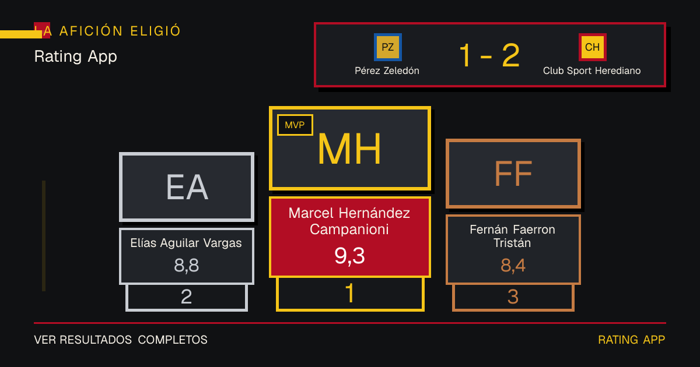
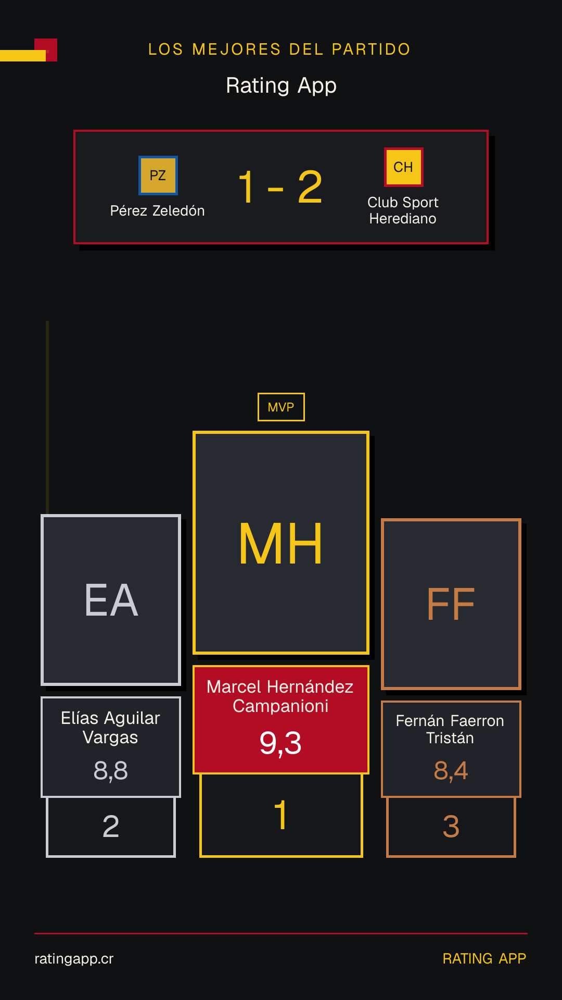

# Issue 122 social sharing samples

These review artifacts use synthetic match and rating values. They exercise the same production renderer with long Player names and missing-photo fallbacks; they are not production evidence or persisted Rating App results.

## Open Graph — 1200 × 630

## Instagram Story — 1080 × 1920

Manual inspection confirmed that both formats preserve the score, all three podium positions, one-decimal ratings, readable wrapped names, explicit MVP and rank labels, and branded initials without clipping. The Story is a downloadable image for manual posting; its printed website address is not a link sticker.
