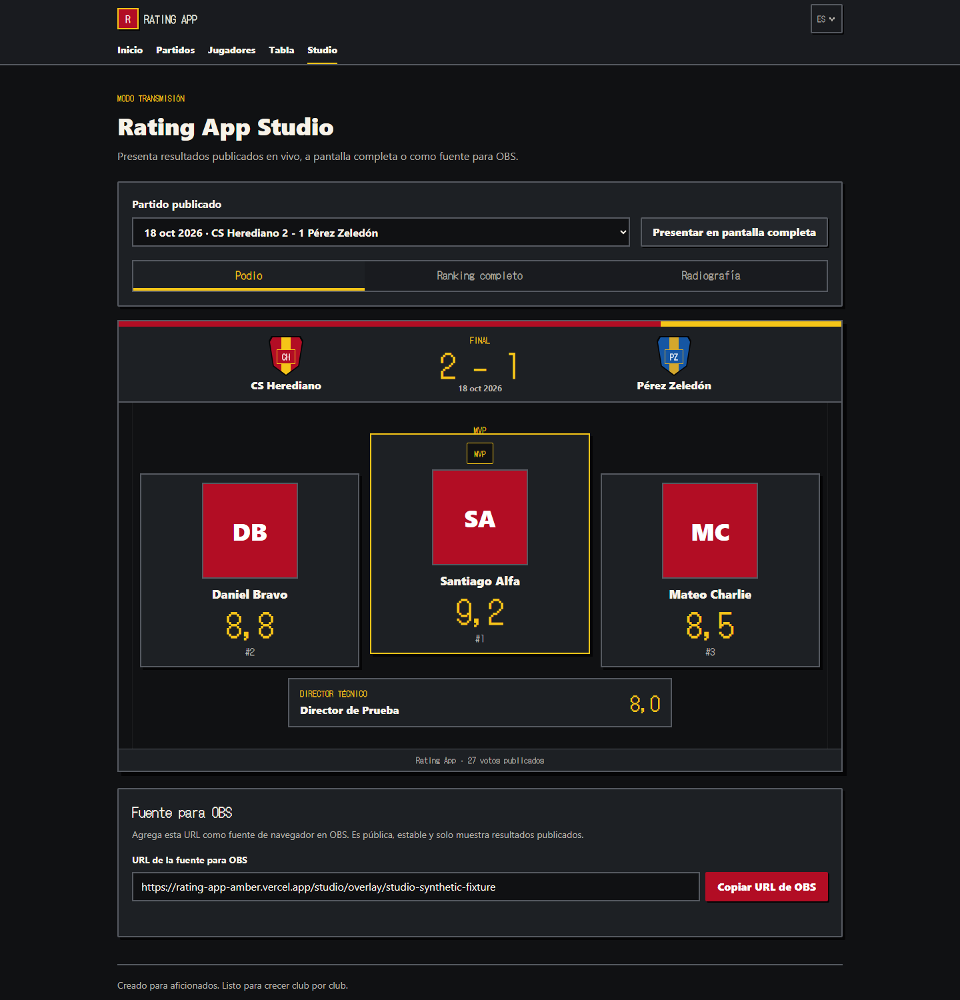
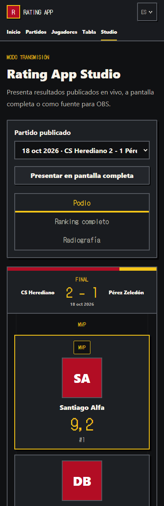
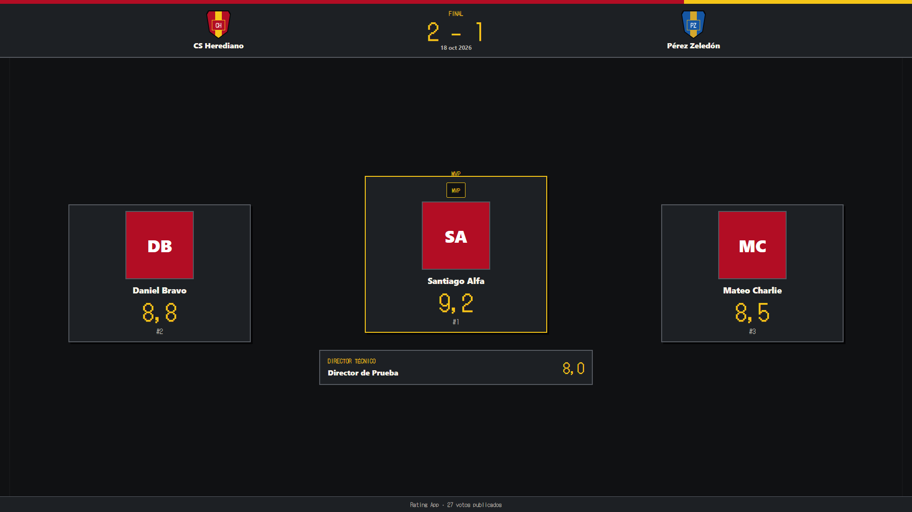

# Rating App Studio V1 screenshots

These screenshots were rendered from synthetic Firebase Emulator data. They demonstrate the delivered UI only; the names, ratings, result, and `studio-synthetic-fixture` URL do not describe production data.

## Desktop Studio

## Mobile Studio

The mobile capture uses a real 390 CSS-pixel viewport. Its measured document `clientWidth` and `scrollWidth` were both 390 pixels, with no overflowing element.

## OBS browser-source overlay

The overlay was captured at 1920×1080 and contains no application navigation or interactive controls.

