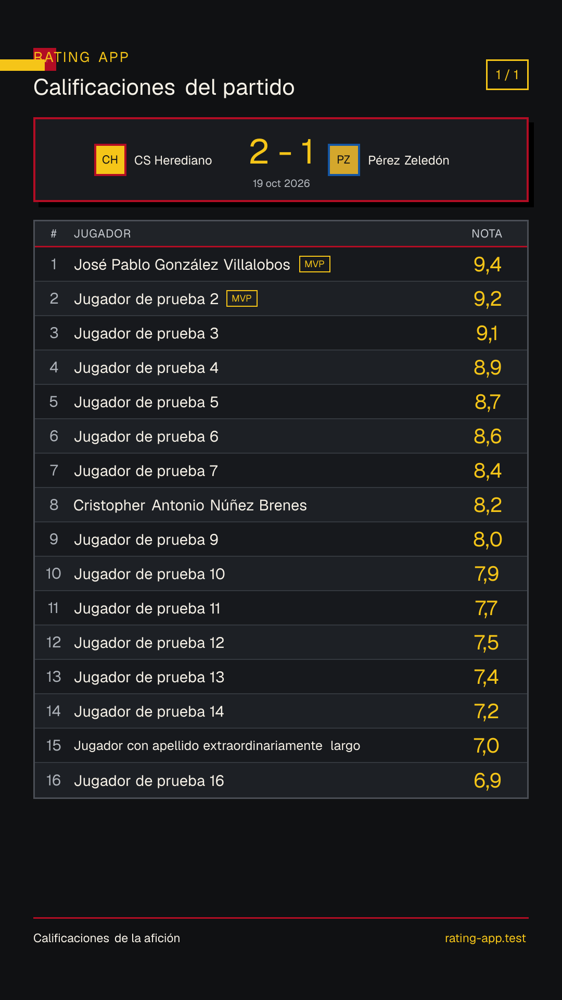
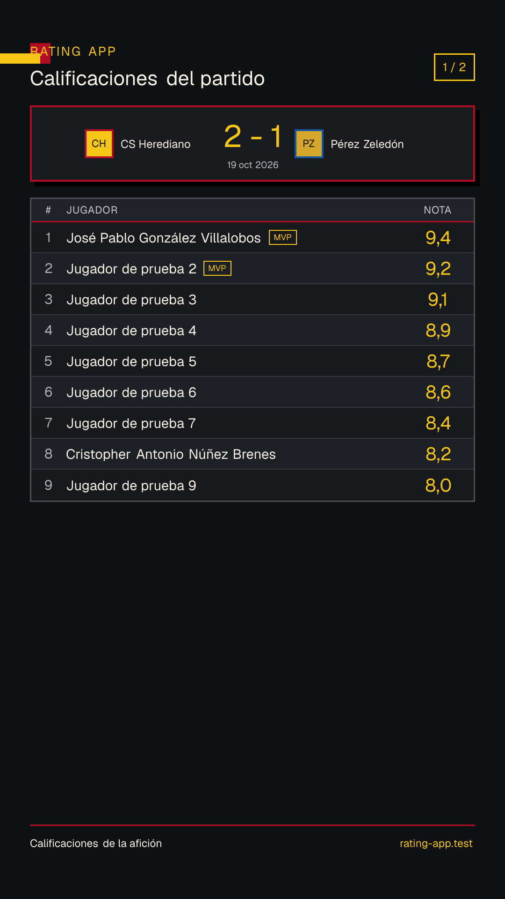
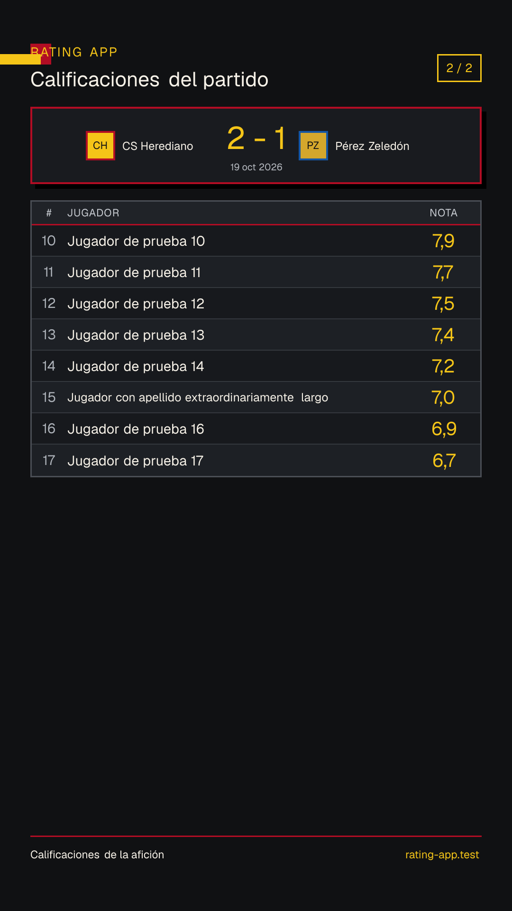

# Full player-rating Story samples

These 1080×1920 PNGs were rendered from synthetic published-result data. They demonstrate Issue #133's presentation and deterministic pagination only; names, ratings, score, date, and `rating-app.test` attribution do not describe production data.

## Full 16-player squad

This is the maximum one-page layout and includes long names plus a shared MVP.

## Balanced multi-Story sequence

A 17-player result uses the minimum two-page sequence, balanced as 9 + 8 rows while preserving canonical ranking order.

